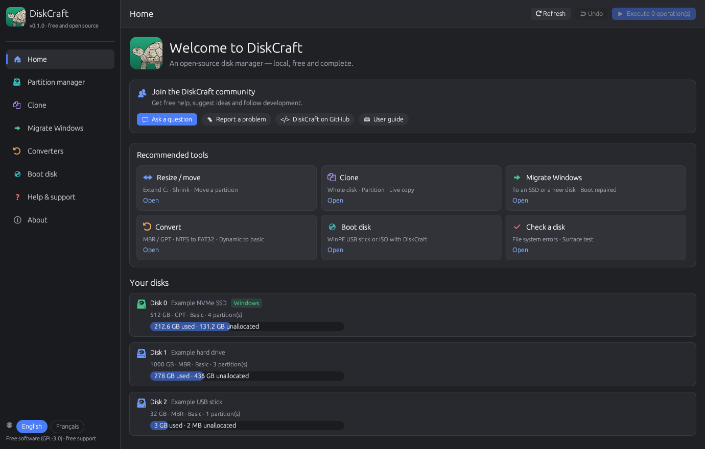
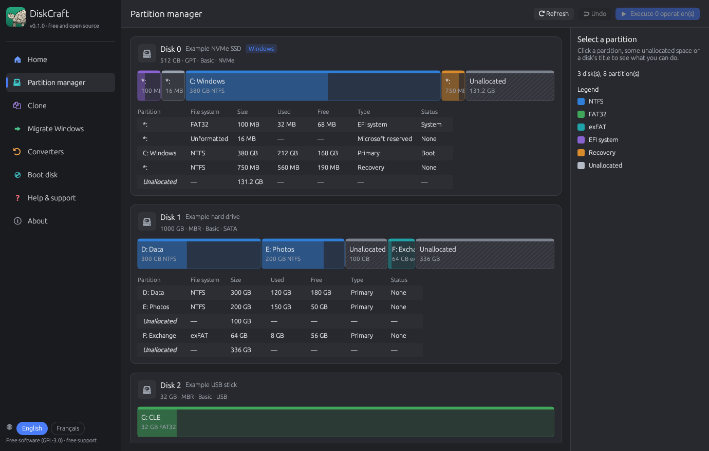
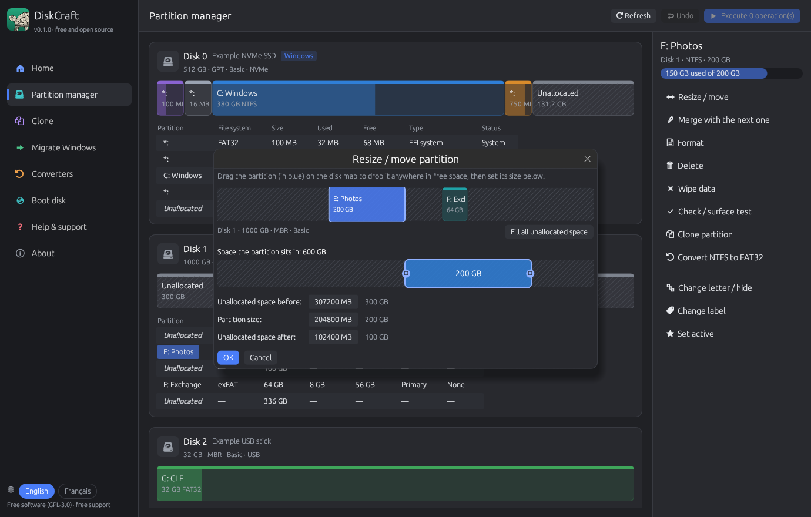

<p align="center">
  
</p>

<h1 align="center">DiskCraft</h1>

<p align="center">
  A free, open-source disk and partition manager for Windows.<br>
  One small program, no account, no ads, no paid tier.
</p>

<p align="center">
  
</p>

> **Status: early preview (v0.1.0).** The disk map, the rules and the operation queue work, but the
> operations that write to disks have not yet been tested widely on real hardware.
> **Back up your data and try DiskCraft on a spare disk first.**

## Features

- **Partition manager**: resize, **move**, merge, create, format, delete, wipe and check partitions
- **Move partitions anywhere**: drag a partition on a map of the whole disk into any free space
- **Clone** a whole disk or a single partition; volumes in use are copied from a snapshot, without rebooting
- **Migrate Windows** to an SSD or a new hard drive, with the boot files rebuilt for you
- **Convert MBR ⇄ GPT** without losing data
- **Convert NTFS to FAT32**, and format FAT32 volumes larger than Windows' 32 GB limit
- **Convert a dynamic disk to a basic disk**
- **Create a bootable WinPE disk** (USB stick or ISO) with DiskCraft inside, to manage the disks of any PC
- **Surface test**: read every sector and report the bad ones
- **Free support** from the community

Nothing is changed until you press **Execute**: every operation first goes into a queue, the disk map
shows the result in advance, and you can undo one step or the whole queue at any time.

## Screenshots

**Partition manager**: every disk as a map, with used space, file system and status for each partition.



**Resize / move**: drag the partition over its neighbours into any free space, then set its size with the handles.



## Download

Get `DiskCraft.exe` from the **Releases** page of this repository. It is a single file: copy it anywhere and run it.

- Windows 10 or 11, or Windows Server 2016 or later, 64-bit
- Older PCs (Windows XP, Vista, 7, 8, Server 2003–2012): build the WinPE boot disk on a recent PC and start the old PC from it
- The program isn't code-signed yet, so Windows SmartScreen may warn you: choose **More info → Run anyway**
- Reading your disks needs no special rights. Windows asks for administrator approval only when you press **Execute**

The interface is in **English and French**. It follows the language of Windows, and you can switch at any time with the language buttons at the bottom left (the choice is remembered).

## How it works

- **Reading disks**: the Windows storage commands (`Get-Disk`, `Get-Partition`, `Get-Volume`), read-only.
- **Queue and preview**: each operation checks its rules (free space, file system, 4 primary partitions on MBR,
  2 TB MBR limit, 4 GB FAT32 file limit…) against the preview of the disks and refuses with a clear message.
- **Execution**: a separate elevated helper (`DiskCraft.exe --worker`) runs the plan step by step and writes a
  log that the window shows live. It uses the Windows storage commands where they are enough, and its own code
  for the rest: sector-by-sector cloning with Volume Shadow Copy snapshots, moving partitions, rewriting MBR/GPT
  tables, writing FAT32 file systems, wiping and surface tests.
- **Migration**: after the copy the new disk gets fresh identifiers and its boot files are rebuilt with
  `bcdboot` (and `bootsect` on BIOS PCs).

## Build from source

DiskCraft is written in Rust, with [egui](https://github.com/emilk/egui) for the window.

```powershell
# Rust's GNU toolchain (no Visual Studio needed); rust-toolchain.toml selects it
rustup toolchain install stable-x86_64-pc-windows-gnu --profile minimal

cargo build --release
# -> target\release\DiskCraft.exe
```

Useful options:

| Option | What it does |
| --- | --- |
| `--demo` | Shows example disks instead of yours (nothing can be executed) |
| `DISKCRAFT_LANG=en` or `fr` | Environment variable that forces the language |
| `--export-logo <folder>` | Writes the logo as PNG files, `.ico` and `.svg` |
| `--screenshot <file.png>` | Opens the window, saves a picture of it and exits |

### Project layout

| Path | Contents |
| --- | --- |
| `src/ui.rs` | The window: pages, disk map, dialogs |
| `src/ops.rs` | Every operation: its rules, its preview and the steps it runs |
| `src/worker.rs` | The elevated helper that carries out the steps |
| `src/gpt.rs` | MBR and GPT partition tables |
| `src/fat32.rs` | FAT32 formatter |
| `src/probe.rs` | Reading the disks |
| `src/winpe.rs` | WinPE boot disk |
| `assets/logo.svg` | The logo, used for the program icon, the window and the app |
| `build.rs` | Puts the logo into the `.exe` icon |

## Contributing

Bug reports, ideas and pull requests are welcome: open an issue. When you report a problem,
include the log shown at the end of the operation (**Open the log**) and the disk information copied
from the **Help & support** page.

## License

DiskCraft is free software, released under the
[GNU General Public License v3.0 or later](https://www.gnu.org/licenses/gpl-3.0.html).
